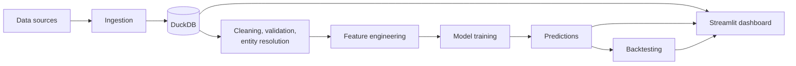

# Soccer Analytics Platform

An end-to-end data platform for soccer match analytics: it ingests match data, cleans and standardizes it, engineers features, trains prediction models, backtests them, and serves the results in an interactive dashboard. Built in Python, SQL, and DuckDB, with a Streamlit front end.


<!-- Add a screenshot at docs/dashboard.png (the main dashboard view) -->

## What it does

- **Ingests** match and team data from [FILL IN: data source(s), e.g. API names or CSV exports]
- **Cleans and validates** records so the downstream models only see consistent data
- **Resolves entities**, matching the same team or player across sources that name them differently [FILL IN: one sentence on how, e.g. normalized names plus a lookup table]
- **Engineers features** for modeling, such as [FILL IN: 2-3 examples, e.g. rolling form, goal difference, home/away splits]
- **Trains models** that produce probabilistic predictions for match outcomes [FILL IN: and any other markets]
- **Backtests** predictions against historical results to measure how well they would have performed
- **Visualizes** everything in a Streamlit dashboard

## Architecture


<!-- Adjust the boxes so the diagram matches how your pipeline really flows -->

## Tech stack

| Area | Tools |
|---|---|
| Language | Python |
| Storage and analytics | DuckDB, SQL |
| Data processing | Pandas |
| Modeling | [FILL IN: e.g. scikit-learn, XGBoost] |
| Dashboard | Streamlit |
| Tooling | Git/GitHub, pytest [FILL IN: confirm] |

## Repository structure

```
Soccer-Analytics-Platform/
├── data/                  # Raw and processed data
├── model_training/        # Feature engineering and model training code
├── streamlit_dashboard/   # Dashboard application
├── tests/                 # Automated tests
├── run_pipeline.py        # Runs the pipeline end to end
├── requirements.txt       # Python dependencies
└── README.md
```

## Getting started

**Requirements:** Python [FILL IN: version you develop with]

```bash
# 1. Clone the repository
git clone https://github.com/risaiahosborne/Soccer-Analytics-Platform.git
cd Soccer-Analytics-Platform

# 2. Create and activate a virtual environment
python -m venv .venv
.venv\Scripts\activate        # Windows
# source .venv/bin/activate   # macOS / Linux

# 3. Install dependencies
pip install -r requirements.txt

# 4. Run the pipeline
python run_pipeline.py

# 5. Launch the dashboard
streamlit run streamlit_dashboard/[FILL IN: app filename].py
```

[FILL IN: any API keys or environment variables needed, and where to put them. Never commit keys.]

## Data

- **Sources:** [FILL IN]
- **Volume:** 5,000+ records ingested and cleaned per run [FILL IN: confirm the exact figure]
- **Storage:** DuckDB database file created by the pipeline [FILL IN: file name and location]
- **Key tables:** [FILL IN: 3-5 table names and what each holds]

## Modeling and backtesting

- **Prediction target:** [FILL IN: e.g. home win / draw / away win probabilities]
- **Model(s):** [FILL IN]
- **Backtest method:** [FILL IN: e.g. train on earlier seasons, predict later ones, no look-ahead]
- **Metrics:** [FILL IN: e.g. log loss, Brier score, accuracy]

| Model | Backtest period | [Metric 1] | [Metric 2] |
|---|---|---|---|
| [FILL IN] | [FILL IN] | [FILL IN] | [FILL IN] |

The platform also computes expected-value (EV) and Kelly-criterion figures from the predicted probabilities as an extra way to read model output.

## Results

- Cut data preparation time by about 40% compared with [FILL IN: the baseline, e.g. the manual notebook workflow it replaced], measured by [FILL IN: how you timed it].

## Testing

```bash
[FILL IN: the command that runs your tests, e.g. python -m pytest]
```

## Design decisions

- **DuckDB** for storage and analytics: [FILL IN: one sentence on why, e.g. fast analytical queries with no server to run]
- **Separating the pipeline from the dashboard** so each can be run and tested on its own
- [FILL IN: one more decision you'd explain in an interview]

## Limitations and roadmap

- Not yet containerized (Docker) and not run on a schedule
- Planned: automated data-quality checks, scheduled pipeline runs, CI to run tests on every push
- [FILL IN: anything else you know is incomplete]

## Disclaimer

This project is for analytics and learning. Predictions are statistical estimates, not betting or financial advice.

## About

Built by **Risaiah Osborne** | [GitHub](https://github.com/risaiahosborne) | [LinkedIn](https://www.linkedin.com/in/risaiah-osborne) | osborne.risaiah@gmail.com
