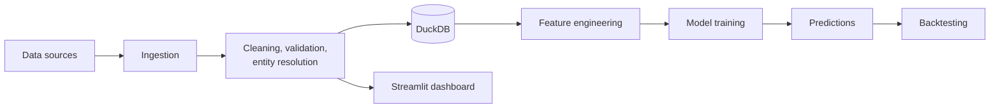

# Soccer Analytics Platform

An end-to-end data platform for soccer match analytics: it ingests match data, cleans and standardizes it, engineers features, trains prediction models, backtests them, and serves the results in an interactive dashboard. Built in Python, SQL, and DuckDB, with a Streamlit front end.

<!-- Add a screenshot at docs/dashboard.png (the main dashboard view) -->

## What it does

- **Ingests** match and team data from open_meteo, understat, football_data_csv, engsoccerdata, football_data_org, the_odds_api 
- **Cleans and validates** records so the downstream models only see consistent data
- **Resolves entities**, matching the same team or player across sources that name them differently
- **Engineers features** for modeling, such as rolling form, home/away splits, over/under frequency
- **Trains models** that produce probabilistic predictions for match outcomes
- **Backtests** predictions against historical results to measure how well they would have performed
- **Visualizes** everything in a Streamlit dashboard

## Architecture


<!-- Adjust the boxes so the diagram matches how your pipeline really flows -->

## Tech stack

| Area | Tools |
|---|---|
| Language | Python |
| Storage and analytics | DuckDB, SQL |
| Data processing | Pandas |
| Modeling | XGBoost |
| Dashboard | Streamlit |
| Tooling | Git/GitHub, pytest |

## Repository structure

```
Soccer-Analytics-Platform/
├── data/                  # Raw and processed data
├── model_training/        # Feature engineering and model training code
├── streamlit_dashboard/   # Dashboard application
├── tests/                 # Automated tests
├── run_pipeline.py        # Runs the pipeline end to end
├── requirements.txt       # Python dependencies
└── README.md
```

## Getting started

**Requirements:** requests==2.34.2 beautifulsoup4==4.15.0 lxml==6.1.1 rapidfuzz==3.14.5 duckdb==1.5.4 pydantic==2.13.4 numpy==2.4.6 pandas==2.3.3 pytest==9.1.1
# The project already includes its own Understat scraper logic, so this package is not required here. understatapi

```bash
# 1. Clone the repository
git clone https://github.com/risaiahosborne/Soccer-Analytics-Platform.git
cd Soccer-Analytics-Platform

# 2. Create and activate a virtual environment
python -m venv .venv
.venv\Scripts\activate        # Windows
# source .venv/bin/activate   # macOS / Linux

# 3. Install dependencies
pip install -r requirements.txt

# 4. Run the pipeline
python run_pipeline.py

# 5. Launch the dashboard
streamlit run streamlit_dashboard/[FILL IN: app filename].py
```

## Data

- **Volume:** 5,000+ records ingested and cleaned per run 
- **Storage:** DuckDB database file created by the pipeline 
- **Key tables:** Teams, Players, Odds, Predictions

## Modeling and backtesting

- **Prediction target:** home win / draw / away win probabilities
- **Backtest method:** train on earlier seasons then predict later ones
- **Metrics:** Accuracy per week per team

The platform also computes expected-value (EV) and Kelly-criterion figures from the predicted probabilities as an extra way to read model output.

## Results

- Seperate Model to compare against commerical products within the industry.
  
## Design decisions

- **DuckDB** for storage and analytics: Fast analytical queries with no server to run
- **Separating the pipeline from the dashboard** so each can be run and tested on its own
- **Cost v Efficiency** project scope and budget contraints

## Limitations and roadmap

- Not yet containerized (Docker) and not run on a schedule
- Planned: automated data-quality checks, scheduled pipeline runs, CI to run tests on every push
- Tracking for personal predictions to results from the algorithm

## Disclaimer

This project is for analytics and learning. Predictions are statistical estimates, not betting or financial advice.

## About

Built by **Risaiah Osborne** | [GitHub](https://github.com/risaiahosborne) | [LinkedIn](https://www.linkedin.com/in/risaiah-osborne) | osborne.risaiah@gmail.com
